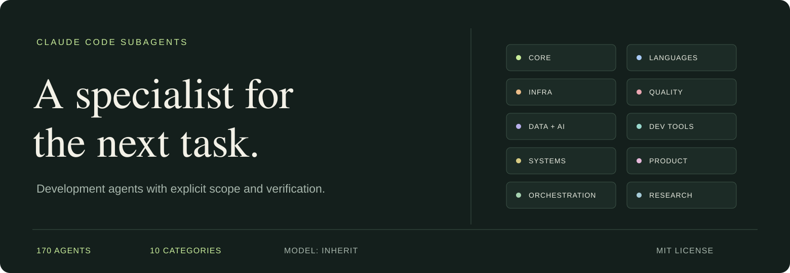

<p align="center">
  
</p>

<h1 align="center">Claude Code Subagents</h1>

<p align="center">Task-focused agents for building, reviewing, debugging, and operating software.</p>

<p align="center">
  <a href="#categories"></a>
  <a href="https://github.com/crankyjediii/claude-code-subagents/actions/workflows/validate.yml"></a>
  <a href="https://github.com/crankyjediii/claude-code-subagents/commits/main"></a>
  <a href="LICENSE"></a>
</p>

<p align="center">
  <a href="#installation">Install</a> · <a href="#usage">Use an agent</a> · <a href="#categories">Browse categories</a> · <a href="#quality">Quality and audit</a> · <a href="CONTRIBUTING.md">Contribute</a>
</p>

170 standalone development agents in 10 categories. Install the categories you use as Claude Code plugins, or copy individual Markdown definitions into a project or your user agents directory.

Each agent has a specific routing trigger, a workflow, a concrete example task, and checks for its result. Definitions inherit your session's model. Tool access varies by role: a code reviewer can inspect files, an implementation agent can edit and run commands, and research agents can fetch sources. See [tool profiles](docs/USAGE.md#tool-profiles) before extending them.

## Installation

### Category plugins

```sh
claude plugin marketplace add crankyjediii/claude-code-subagents
claude plugin install voltagent-core-dev@voltagent-subagents
```

Choose a plugin from the [category index](#categories). Use the full `plugin@voltagent-subagents` identifier so Claude Code resolves it from this marketplace.

```sh
claude plugin install voltagent-lang@voltagent-subagents     # Language specialists
claude plugin install voltagent-quality@voltagent-subagents  # Review, testing, security
```

> `voltagent-meta` works best with specialists from other categories installed. Its agents check which tools and specialists are available and provide a parent-executable plan when delegation is unavailable.

<details>
<summary><strong>Interactive installer</strong> · browse categories and select individual agents</summary>

```sh
git clone https://github.com/crankyjediii/claude-code-subagents.git
cd claude-code-subagents
bash install-agents.sh
```

Choose project or global scope, browse a category, and select names or the full category. The browser supports installation and removal. Explicit CLI commands are also available:

```sh
bash install-agents.sh --install python-specialist,code-reviewer --project .
bash install-agents.sh --install --category voltagent-infra --global --dry-run
```

</details>

<details>
<summary><strong>Standalone installer</strong> · no clone required</summary>

Download and inspect the script, then run it:

```sh
curl --fail --location --proto '=https' --proto-redir '=https' \
  https://raw.githubusercontent.com/crankyjediii/claude-code-subagents/main/install-agents.sh \
  -o install-agents.sh
bash install-agents.sh --standalone
```

Requires Bash 3.2+, standard Unix utilities, `curl`, and `sha256sum` or `shasum`. The script downloads only the selected definitions. For repeatable downloads, pin the script URL and `--ref` to the same commit. The [installation guide](docs/INSTALLATION.md) covers source overrides, conflict handling, and recovery.

</details>

<details>
<summary><strong>Manual installation</strong> · copy a definition you have reviewed</summary>

From a checkout:

```sh
mkdir -p .claude/agents
cp categories/02-language-specialists/agents/python-specialist.md .claude/agents/
```

Use `~/.claude/agents/` for global availability. Manual copies are not owned by the shell installer; remove them manually or explicitly adopt them with the installer's backed-up `--force` operation.

</details>

<details>
<summary><strong>Agent installer</strong> · ask Claude Code to browse and install</summary>

Place [agent-installer.md](agent-installer.md) in the intended agents directory:

```sh
mkdir -p .claude/agents
curl --fail --location --proto '=https' --proto-redir '=https' \
  https://raw.githubusercontent.com/crankyjediii/claude-code-subagents/main/agent-installer.md \
  -o .claude/agents/agent-installer.md
```

Review the file, start a new Claude Code session, and ask: “Use agent-installer to install python-specialist in this project.” The definition includes source discovery and target selection, so it works without the rest of the checkout.

</details>

For updates, uninstalling, scope precedence, and troubleshooting, use the [installation guide](docs/INSTALLATION.md).

## Usage

Start a new Claude Code session after installation and check `/agents`. Name the specialist and give it a bounded task:

```text
Use the code-reviewer agent from voltagent-quality to review the current diff.
Focus on retry behavior and duplicate side effects. Report findings with file
locations and a concrete failure scenario; do not modify the patch.
```

Useful starting points:

- **Implement a server feature:** `backend-developer` in `voltagent-core-dev`.
- **Trace a defect and repair it:** `debugging-specialist` in `voltagent-dx`.
- **Review an existing change:** `code-reviewer` in `voltagent-quality`.
- **Map an unfamiliar repository:** `codebase-explorer` in `voltagent-research`.
- **Plan work across specialists:** `agent-organizer` in `voltagent-meta`.

Specify the expected result, constraints, relevant files, and checks. The [usage guide](docs/USAGE.md) explains overlapping roles, tool profiles, and a complete agent definition.

## Categories

<!-- catalog:start -->

| Category | Plugin | Agents |
| :-- | :-- | --: |
| [01 · Core development](categories/01-core-development/README.md) | `voltagent-core-dev` | 17 |
| [02 · Language specialists](categories/02-language-specialists/README.md) | `voltagent-lang` | 17 |
| [03 · Infrastructure and operations](categories/03-infrastructure/README.md) | `voltagent-infra` | 17 |
| [04 · Quality and security](categories/04-quality-security/README.md) | `voltagent-quality` | 17 |
| [05 · Data and AI](categories/05-data-ai/README.md) | `voltagent-data-ai` | 17 |
| [06 · Developer experience](categories/06-developer-experience/README.md) | `voltagent-dx` | 17 |
| [07 · Specialized domains](categories/07-specialized-domains/README.md) | `voltagent-domains` | 17 |
| [08 · Product and delivery](categories/08-business-product/README.md) | `voltagent-product` | 17 |
| [09 · Meta orchestration](categories/09-meta-orchestration/README.md) | `voltagent-meta` | 17 |
| [10 · Research and analysis](categories/10-research-analysis/README.md) | `voltagent-research` | 17 |

Expand a category to browse its agents.

<details>
<summary><strong>01 · Core development</strong> · 17 agents</summary>

Plugin: `voltagent-core-dev` · [Category guide](categories/01-core-development/README.md)

- [api-designer](categories/01-core-development/agents/api-designer.md): Design HTTP API contracts and compatibility rules.
- [authentication-engineer](categories/01-core-development/agents/authentication-engineer.md): Implement login, sessions, and account recovery.
- [authorization-engineer](categories/01-core-development/agents/authorization-engineer.md): Enforce resource access and tenant isolation.
- [backend-developer](categories/01-core-development/agents/backend-developer.md): Implement server-side features and service boundaries.
- [cache-engineer](categories/01-core-development/agents/cache-engineer.md): Add caching with explicit consistency and invalidation rules.
- [cli-developer](categories/01-core-development/agents/cli-developer.md): Build command-line interfaces that compose with other tools.
- [database-designer](categories/01-core-development/agents/database-designer.md): Design relational schemas around access patterns and invariants.
- [desktop-developer](categories/01-core-development/agents/desktop-developer.md): Build desktop application features and native integrations.
- [event-driven-developer](categories/01-core-development/agents/event-driven-developer.md): Implement durable event publication and consumption.
- [frontend-developer](categories/01-core-development/agents/frontend-developer.md): Build browser interfaces with clear state and accessible controls.
- [fullstack-developer](categories/01-core-development/agents/fullstack-developer.md): Deliver features across UI, API, and persistence.
- [graphql-developer](categories/01-core-development/agents/graphql-developer.md): Implement GraphQL schemas and efficient resolvers.
- [microservices-architect](categories/01-core-development/agents/microservices-architect.md): Define service boundaries and cross-service failure handling.
- [mobile-developer](categories/01-core-development/agents/mobile-developer.md): Implement mobile flows resilient to lifecycle and network changes.
- [payment-integrator](categories/01-core-development/agents/payment-integrator.md): Implement payment state transitions and webhook processing.
- [search-engineer](categories/01-core-development/agents/search-engineer.md): Implement application search and relevance tuning.
- [websocket-engineer](categories/01-core-development/agents/websocket-engineer.md): Build persistent bidirectional messaging flows.

</details>

<details>
<summary><strong>02 · Language specialists</strong> · 17 agents</summary>

Plugin: `voltagent-lang` · [Category guide](categories/02-language-specialists/README.md)

- [c-specialist](categories/02-language-specialists/agents/c-specialist.md): Implement C with explicit bounds and resource cleanup.
- [cpp-specialist](categories/02-language-specialists/agents/cpp-specialist.md): Implement C++ with explicit ownership and lifetime guarantees.
- [csharp-specialist](categories/02-language-specialists/agents/csharp-specialist.md): Implement C# and .NET features with safe async and disposal.
- [elixir-specialist](categories/02-language-specialists/agents/elixir-specialist.md): Implement Elixir systems with explicit process and supervision behavior.
- [go-specialist](categories/02-language-specialists/agents/go-specialist.md): Implement Go services with explicit errors and bounded concurrency.
- [java-specialist](categories/02-language-specialists/agents/java-specialist.md): Implement Java services and diagnose JVM code behavior.
- [javascript-specialist](categories/02-language-specialists/agents/javascript-specialist.md): Fix JavaScript behavior across asynchronous and runtime boundaries.
- [kotlin-specialist](categories/02-language-specialists/agents/kotlin-specialist.md): Implement Kotlin with safe nullability and structured concurrency.
- [php-specialist](categories/02-language-specialists/agents/php-specialist.md): Implement PHP applications with explicit input and type boundaries.
- [python-specialist](categories/02-language-specialists/agents/python-specialist.md): Write idiomatic Python and diagnose runtime or packaging issues.
- [ruby-specialist](categories/02-language-specialists/agents/ruby-specialist.md): Implement Ruby behavior and maintain predictable object contracts.
- [rust-specialist](categories/02-language-specialists/agents/rust-specialist.md): Implement Rust code with clear ownership and error contracts.
- [scala-specialist](categories/02-language-specialists/agents/scala-specialist.md): Implement Scala with precise effects and collection behavior.
- [shell-specialist](categories/02-language-specialists/agents/shell-specialist.md): Write portable shell automation and diagnose quoting or process issues.
- [sql-specialist](categories/02-language-specialists/agents/sql-specialist.md): Write correct SQL and diagnose expensive database queries.
- [swift-specialist](categories/02-language-specialists/agents/swift-specialist.md): Implement Swift features with clear isolation and value semantics.
- [typescript-specialist](categories/02-language-specialists/agents/typescript-specialist.md): Model TypeScript boundaries and strengthen type safety.

</details>

<details>
<summary><strong>03 · Infrastructure and operations</strong> · 17 agents</summary>

Plugin: `voltagent-infra` · [Category guide](categories/03-infrastructure/README.md)

- [backup-engineer](categories/03-infrastructure/agents/backup-engineer.md): Implement backups with tested recovery behavior.
- [ci-pipeline-engineer](categories/03-infrastructure/agents/ci-pipeline-engineer.md): Make CI workflows repeatable and useful to contributors.
- [cloud-architect](categories/03-infrastructure/agents/cloud-architect.md): Design cloud infrastructure from workload and operational constraints.
- [container-engineer](categories/03-infrastructure/agents/container-engineer.md): Build reproducible container images and predictable runtime behavior.
- [cost-optimization-engineer](categories/03-infrastructure/agents/cost-optimization-engineer.md): Reduce infrastructure costs using measured workload behavior.
- [database-administrator](categories/03-infrastructure/agents/database-administrator.md): Operate databases through backup, replication, and maintenance events.
- [devops-engineer](categories/03-infrastructure/agents/devops-engineer.md): Improve build, delivery, and operational workflows.
- [incident-responder](categories/03-infrastructure/agents/incident-responder.md): Investigate service incidents and coordinate recovery evidence.
- [kubernetes-engineer](categories/03-infrastructure/agents/kubernetes-engineer.md): Implement Kubernetes workloads and safe rollout behavior.
- [linux-administrator](categories/03-infrastructure/agents/linux-administrator.md): Diagnose Linux process, storage, and service failures.
- [network-engineer](categories/03-infrastructure/agents/network-engineer.md): Diagnose routing, DNS, TLS, and connectivity failures.
- [observability-engineer](categories/03-infrastructure/agents/observability-engineer.md): Instrument services with actionable metrics, logs, and traces.
- [platform-engineer](categories/03-infrastructure/agents/platform-engineer.md): Build internal development platforms around recurring team needs.
- [release-engineer](categories/03-infrastructure/agents/release-engineer.md): Package and release versioned artifacts with provenance.
- [secrets-engineer](categories/03-infrastructure/agents/secrets-engineer.md): Design secret storage, rotation, and workload identity flows.
- [site-reliability-engineer](categories/03-infrastructure/agents/site-reliability-engineer.md): Diagnose reliability gaps using service-level evidence.
- [terraform-engineer](categories/03-infrastructure/agents/terraform-engineer.md): Manage infrastructure as code with controlled state changes.

</details>

<details>
<summary><strong>04 · Quality and security</strong> · 17 agents</summary>

Plugin: `voltagent-quality` · [Category guide](categories/04-quality-security/README.md)

- [accessibility-auditor](categories/04-quality-security/agents/accessibility-auditor.md): Review interfaces for keyboard and assistive-technology barriers.
- [chaos-engineer](categories/04-quality-security/agents/chaos-engineer.md): Test system recovery through bounded failure experiments.
- [code-reviewer](categories/04-quality-security/agents/code-reviewer.md): Review changes for concrete defects and maintainability risks.
- [contract-testing-engineer](categories/04-quality-security/agents/contract-testing-engineer.md): Verify compatibility between independently deployed components.
- [dependency-auditor](categories/04-quality-security/agents/dependency-auditor.md): Assess dependencies for reachable vulnerabilities and upgrade risks.
- [e2e-test-engineer](categories/04-quality-security/agents/e2e-test-engineer.md): Test complete user journeys across application boundaries.
- [fuzz-testing-engineer](categories/04-quality-security/agents/fuzz-testing-engineer.md): Find parser and boundary failures through fuzz testing.
- [load-testing-engineer](categories/04-quality-security/agents/load-testing-engineer.md): Measure capacity and degradation under controlled load.
- [mutation-testing-engineer](categories/04-quality-security/agents/mutation-testing-engineer.md): Evaluate whether tests detect meaningful behavior changes.
- [penetration-tester](categories/04-quality-security/agents/penetration-tester.md): Conduct explicitly authorized application penetration tests.
- [performance-engineer](categories/04-quality-security/agents/performance-engineer.md): Find application bottlenecks using representative measurements.
- [privacy-engineer](categories/04-quality-security/agents/privacy-engineer.md): Reduce unnecessary personal-data collection and exposure.
- [regression-triager](categories/04-quality-security/agents/regression-triager.md): Reduce reported failures to a cause and a useful regression case.
- [security-auditor](categories/04-quality-security/agents/security-auditor.md): Audit code for exploitable trust-boundary failures.
- [static-analysis-engineer](categories/04-quality-security/agents/static-analysis-engineer.md): Tune static analysis to detect actionable defects.
- [test-engineer](categories/04-quality-security/agents/test-engineer.md): Design tests around behavior and failure boundaries.
- [threat-modeler](categories/04-quality-security/agents/threat-modeler.md): Model application threats and concrete mitigation boundaries.

</details>

<details>
<summary><strong>05 · Data and AI</strong> · 17 agents</summary>

Plugin: `voltagent-data-ai` · [Category guide](categories/05-data-ai/README.md)

- [analytics-engineer](categories/05-data-ai/agents/analytics-engineer.md): Build auditable analytical models and metric definitions.
- [computer-vision-engineer](categories/05-data-ai/agents/computer-vision-engineer.md): Implement image-model pipelines and evaluate visual failure modes.
- [data-engineer](categories/05-data-ai/agents/data-engineer.md): Build reliable ingestion and transformation pipelines.
- [data-quality-engineer](categories/05-data-ai/agents/data-quality-engineer.md): Detect and contain data defects at ingestion and model boundaries.
- [data-scientist](categories/05-data-ai/agents/data-scientist.md): Analyze datasets with reproducible statistical reasoning.
- [etl-developer](categories/05-data-ai/agents/etl-developer.md): Implement extraction and loading with recoverable checkpoints.
- [feature-engineer](categories/05-data-ai/agents/feature-engineer.md): Create model features available at prediction time.
- [llm-engineer](categories/05-data-ai/agents/llm-engineer.md): Build language-model features with bounded tools and measured quality.
- [machine-learning-engineer](categories/05-data-ai/agents/machine-learning-engineer.md): Train and integrate models with reproducible evaluation.
- [mlops-engineer](categories/05-data-ai/agents/mlops-engineer.md): Operate model training, promotion, and rollback workflows.
- [model-evaluation-engineer](categories/05-data-ai/agents/model-evaluation-engineer.md): Design model evaluations that expose consequential failures.
- [nlp-engineer](categories/05-data-ai/agents/nlp-engineer.md): Build text-processing pipelines with language-aware evaluation.
- [prompt-engineer](categories/05-data-ai/agents/prompt-engineer.md): Improve task instructions against representative examples.
- [rag-engineer](categories/05-data-ai/agents/rag-engineer.md): Implement retrieval-augmented answers with traceable evidence.
- [recommendation-engineer](categories/05-data-ai/agents/recommendation-engineer.md): Build recommendation systems with realistic offline and online constraints.
- [stream-processing-engineer](categories/05-data-ai/agents/stream-processing-engineer.md): Process event streams with explicit time and state semantics.
- [vector-search-engineer](categories/05-data-ai/agents/vector-search-engineer.md): Design embedding indexes and approximate-nearest-neighbor retrieval.

</details>

<details>
<summary><strong>06 · Developer experience</strong> · 17 agents</summary>

Plugin: `voltagent-dx` · [Category guide](categories/06-developer-experience/README.md)

- [api-documenter](categories/06-developer-experience/agents/api-documenter.md): Document API behavior and runnable request examples.
- [build-engineer](categories/06-developer-experience/agents/build-engineer.md): Diagnose builds and reduce avoidable compilation work.
- [changelog-maintainer](categories/06-developer-experience/agents/changelog-maintainer.md): Write release notes from verified changes and consumer impact.
- [code-generator](categories/06-developer-experience/agents/code-generator.md): Build repeatable source generation from explicit schemas.
- [debugging-specialist](categories/06-developer-experience/agents/debugging-specialist.md): Find defects through hypotheses and minimal reproductions.
- [dependency-manager](categories/06-developer-experience/agents/dependency-manager.md): Upgrade dependency sets while preserving compatibility.
- [developer-onboarding](categories/06-developer-experience/agents/developer-onboarding.md): Make first-run setup reproducible for new contributors.
- [development-environment-engineer](categories/06-developer-experience/agents/development-environment-engineer.md): Build consistent local environments across supported hosts.
- [documentation-engineer](categories/06-developer-experience/agents/documentation-engineer.md): Write technical documentation that matches running code.
- [git-workflow-specialist](categories/06-developer-experience/agents/git-workflow-specialist.md): Repair Git workflows and explain repository history safely.
- [legacy-modernizer](categories/06-developer-experience/agents/legacy-modernizer.md): Migrate legacy components through reversible increments.
- [linting-specialist](categories/06-developer-experience/agents/linting-specialist.md): Configure formatting and lint rules with manageable adoption.
- [migration-planner](categories/06-developer-experience/agents/migration-planner.md): Plan software migrations with measurable completion criteria.
- [monorepo-engineer](categories/06-developer-experience/agents/monorepo-engineer.md): Maintain package boundaries and coordinated monorepo workflows.
- [package-maintainer](categories/06-developer-experience/agents/package-maintainer.md): Publish installable packages with clear compatibility contracts.
- [refactoring-specialist](categories/06-developer-experience/agents/refactoring-specialist.md): Restructure code while preserving externally observable behavior.
- [repository-maintainer](categories/06-developer-experience/agents/repository-maintainer.md): Maintain repository metadata, contributor workflows, and automation.

</details>

<details>
<summary><strong>07 · Specialized domains</strong> · 17 agents</summary>

Plugin: `voltagent-domains` · [Category guide](categories/07-specialized-domains/README.md)

- [audio-engineer](categories/07-specialized-domains/agents/audio-engineer.md): Build audio processing with bounded latency and signal correctness.
- [blockchain-engineer](categories/07-specialized-domains/agents/blockchain-engineer.md): Implement ledger integrations and smart-contract behavior.
- [browser-extension-engineer](categories/07-specialized-domains/agents/browser-extension-engineer.md): Build browser extensions with constrained permissions and reliable messaging.
- [compiler-engineer](categories/07-specialized-domains/agents/compiler-engineer.md): Implement parsing, semantic analysis, and code generation.
- [distributed-systems-engineer](categories/07-specialized-domains/agents/distributed-systems-engineer.md): Design protocols that survive partial failure and concurrency.
- [embedded-engineer](categories/07-specialized-domains/agents/embedded-engineer.md): Implement firmware with bounded resources and hardware-aware timing.
- [gameplay-engineer](categories/07-specialized-domains/agents/gameplay-engineer.md): Implement gameplay rules and predictable entity interactions.
- [geospatial-engineer](categories/07-specialized-domains/agents/geospatial-engineer.md): Process spatial data with correct reference systems and geometry.
- [graphics-engineer](categories/07-specialized-domains/agents/graphics-engineer.md): Implement rendering features and diagnose GPU pipeline issues.
- [iot-engineer](categories/07-specialized-domains/agents/iot-engineer.md): Build connected-device protocols and resilient provisioning flows.
- [protocol-engineer](categories/07-specialized-domains/agents/protocol-engineer.md): Design interoperable wire formats and stateful communication.
- [realtime-systems-engineer](categories/07-specialized-domains/agents/realtime-systems-engineer.md): Implement time-bounded work with explicit deadlines.
- [robotics-engineer](categories/07-specialized-domains/agents/robotics-engineer.md): Implement robotics software with explicit coordinate and timing contracts.
- [scientific-computing-engineer](categories/07-specialized-domains/agents/scientific-computing-engineer.md): Implement numerical methods with checked accuracy and stability.
- [simulation-engineer](categories/07-specialized-domains/agents/simulation-engineer.md): Build repeatable simulations and validate model behavior.
- [storage-engineer](categories/07-specialized-domains/agents/storage-engineer.md): Implement durable storage and recoverable data structures.
- [video-engineer](categories/07-specialized-domains/agents/video-engineer.md): Implement video pipelines with explicit timing and codec behavior.

</details>

<details>
<summary><strong>08 · Product and delivery</strong> · 17 agents</summary>

Plugin: `voltagent-product` · [Category guide](categories/08-business-product/README.md)

- [acceptance-tester](categories/08-business-product/agents/acceptance-tester.md): Verify delivered behavior against agreed product criteria.
- [agile-facilitator](categories/08-business-product/agents/agile-facilitator.md): Improve team planning and feedback through concrete workflow changes.
- [business-analyst](categories/08-business-product/agents/business-analyst.md): Translate business processes into implementable rules.
- [design-system-engineer](categories/08-business-product/agents/design-system-engineer.md): Build reusable components with documented interaction contracts.
- [domain-modeler](categories/08-business-product/agents/domain-modeler.md): Model business concepts and invariants in code boundaries.
- [experiment-designer](categories/08-business-product/agents/experiment-designer.md): Design product experiments with valid measurement and stopping rules.
- [issue-triager](categories/08-business-product/agents/issue-triager.md): Turn incoming reports into actionable engineering issues.
- [localization-engineer](categories/08-business-product/agents/localization-engineer.md): Prepare software for translation and locale-sensitive behavior.
- [product-analytics-engineer](categories/08-business-product/agents/product-analytics-engineer.md): Instrument user behavior with stable event and metric definitions.
- [product-manager](categories/08-business-product/agents/product-manager.md): Turn product requests into testable development scope.
- [requirements-engineer](categories/08-business-product/agents/requirements-engineer.md): Specify software behavior with traceable acceptance examples.
- [roadmap-planner](categories/08-business-product/agents/roadmap-planner.md): Sequence product work using explicit evidence and dependencies.
- [technical-estimator](categories/08-business-product/agents/technical-estimator.md): Estimate engineering work from decomposed scope and uncertainty.
- [technical-program-manager](categories/08-business-product/agents/technical-program-manager.md): Coordinate dependent engineering work with visible decision points.
- [technical-writer](categories/08-business-product/agents/technical-writer.md): Explain development workflows for a specific reader.
- [ux-designer](categories/08-business-product/agents/ux-designer.md): Design task flows with explicit states and interaction behavior.
- [ux-researcher](categories/08-business-product/agents/ux-researcher.md): Plan user research and interpret evidence without invented findings.

</details>

<details>
<summary><strong>09 · Meta orchestration</strong> · 17 agents</summary>

Plugin: `voltagent-meta` · [Category guide](categories/09-meta-orchestration/README.md)

- [agent-designer](categories/09-meta-orchestration/agents/agent-designer.md): Write focused Claude Code agent definitions with clear triggers.
- [agent-organizer](categories/09-meta-orchestration/agents/agent-organizer.md): Match development tasks to installed specialist agents.
- [architecture-coordinator](categories/09-meta-orchestration/agents/architecture-coordinator.md): Reconcile design choices across components and specialist teams.
- [conflict-resolver](categories/09-meta-orchestration/agents/conflict-resolver.md): Resolve overlapping code changes while preserving intended behavior.
- [context-manager](categories/09-meta-orchestration/agents/context-manager.md): Prepare compact handoffs that preserve actionable task state.
- [dependency-coordinator](categories/09-meta-orchestration/agents/dependency-coordinator.md): Manage task dependencies and unblock work in the right order.
- [handoff-coordinator](categories/09-meta-orchestration/agents/handoff-coordinator.md): Transfer work between specialists with complete operational context.
- [knowledge-synthesizer](categories/09-meta-orchestration/agents/knowledge-synthesizer.md): Combine specialist findings into a traceable engineering decision.
- [multi-agent-debugger](categories/09-meta-orchestration/agents/multi-agent-debugger.md): Diagnose failures across delegated development tasks.
- [parallel-coordinator](categories/09-meta-orchestration/agents/parallel-coordinator.md): Coordinate independent workers without file ownership conflicts.
- [plan-reviewer](categories/09-meta-orchestration/agents/plan-reviewer.md): Review implementation plans for missing dependencies and invalid assumptions.
- [progress-auditor](categories/09-meta-orchestration/agents/progress-auditor.md): Compare task status with actual artifacts and verification evidence.
- [review-coordinator](categories/09-meta-orchestration/agents/review-coordinator.md): Coordinate focused reviews and remove duplicate or unsupported findings.
- [task-decomposer](categories/09-meta-orchestration/agents/task-decomposer.md): Break complex requests into independently verifiable work.
- [verification-coordinator](categories/09-meta-orchestration/agents/verification-coordinator.md): Choose and run checks that establish task completion.
- [workflow-optimizer](categories/09-meta-orchestration/agents/workflow-optimizer.md): Reduce unnecessary coordination and repeated work in agent workflows.
- [workflow-orchestrator](categories/09-meta-orchestration/agents/workflow-orchestrator.md): Coordinate implementation, review, and verification stages.

</details>

<details>
<summary><strong>10 · Research and analysis</strong> · 17 agents</summary>

Plugin: `voltagent-research` · [Category guide](categories/10-research-analysis/README.md)

- [algorithm-analyst](categories/10-research-analysis/agents/algorithm-analyst.md): Analyze algorithm correctness, complexity, and practical constraints.
- [architecture-analyst](categories/10-research-analysis/agents/architecture-analyst.md): Assess an existing system's structure and engineering tradeoffs.
- [benchmark-analyst](categories/10-research-analysis/agents/benchmark-analyst.md): Design fair software benchmarks and interpret measurements.
- [codebase-explorer](categories/10-research-analysis/agents/codebase-explorer.md): Map unfamiliar repositories and trace actual execution paths.
- [competitive-technical-analyst](categories/10-research-analysis/agents/competitive-technical-analyst.md): Compare public product capabilities for an engineering decision.
- [data-analyst](categories/10-research-analysis/agents/data-analyst.md): Answer practical questions with reproducible data transformations.
- [dependency-researcher](categories/10-research-analysis/agents/dependency-researcher.md): Investigate library behavior, maintenance, and integration suitability.
- [failure-pattern-researcher](categories/10-research-analysis/agents/failure-pattern-researcher.md): Investigate recurring defects across incidents and code changes.
- [feasibility-analyst](categories/10-research-analysis/agents/feasibility-analyst.md): Assess whether a development proposal can meet stated constraints.
- [log-analyst](categories/10-research-analysis/agents/log-analyst.md): Extract diagnostic evidence from application and infrastructure logs.
- [repository-auditor](categories/10-research-analysis/agents/repository-auditor.md): Audit repository contents, maintenance rules, and distribution health.
- [research-synthesizer](categories/10-research-analysis/agents/research-synthesizer.md): Combine technical research into a decision-ready evidence summary.
- [root-cause-analyst](categories/10-research-analysis/agents/root-cause-analyst.md): Explain failures through a defensible causal chain.
- [source-verifier](categories/10-research-analysis/agents/source-verifier.md): Verify technical claims, citations, and quoted material.
- [standards-researcher](categories/10-research-analysis/agents/standards-researcher.md): Interpret technical standards and map them to implementation choices.
- [technical-researcher](categories/10-research-analysis/agents/technical-researcher.md): Research engineering questions using verifiable primary sources.
- [technology-evaluator](categories/10-research-analysis/agents/technology-evaluator.md): Compare technologies against a concrete development requirement.

</details>

<!-- catalog:end -->

## Quality

The collection has a source-level review record for every category agent, with a concrete task, expected behavior, tool profile, and reviewed source digest. The [release audit](docs/AUDIT.md) records findings, fixes, and verification limits; the [per-agent review](docs/AGENT_REVIEW.md) covers all definitions.

CI checks source structure, review coverage, generated-file drift, documentation links, ShellCheck, isolated installer behavior on Linux and macOS, and actual discovery of every plugin agent in Claude Code. Installer tests cover failed downloads, modified files, backups, lock contention, and partial-category removal.

The review cases are illustrative examples, not a held-out benchmark. They do not establish end-to-end model performance across 170 development tasks. Review the instructions and declared tools for your environment. [Security and trust boundaries](SECURITY.md) describe what the installer and agent definitions do and do not enforce.

## Contributing

Improve an existing definition, propose a task the collection does not cover, or report a reproducible installation problem. Follow [CONTRIBUTING.md](CONTRIBUTING.md) for the format, review requirements, and maintenance commands.

Agent definitions must be useful and vendor-neutral. Contributions whose main purpose is promoting a product, company, or personal project are not accepted. Category names and plugin identifiers are kept stable for existing users.

## Sponsors

No sponsors are listed. Paid listings belong in this section, separate from agent instructions. [Open a sponsorship inquiry](https://github.com/crankyjediii/claude-code-subagents/issues/new?template=sponsorship.yml) for listing details; do not include private billing information in a public issue.

## License

[MIT](LICENSE). See [CHANGELOG.md](CHANGELOG.md) for changes and [maintenance instructions](docs/MAINTENANCE.md) for release procedures.
